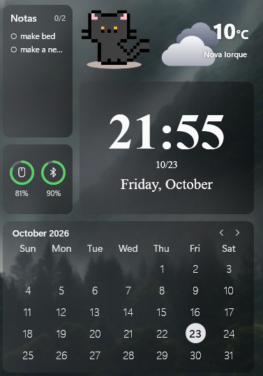

<div align="center">


# DeskWidgets

**Relógio, calendário, clima, música, pomodoro, temperaturas, bateria e checklist direto na sua área de trabalho.**
Personalizável, nativo do Windows e tão leve que você esquece que está aberto.

[](https://github.com/BenjamimCYT/DeskWidgets/releases/latest)
[](https://github.com/BenjamimCYT/DeskWidgets/releases)
[](#requisitos)


### [⬇ Baixar a versão mais recente](https://github.com/BenjamimCYT/DeskWidgets/releases/latest)



</div>

---

## ✨ O que tem

Cada widget é **independente**: arraste para onde quiser, redimensione pelo canto e escolha um tema só para ele.

| | |
|---|---|
| 🕐 **Relógio** | Qualquer fonte instalada no PC, 12 ou 24 h, segundos e data opcionais |
| 📅 **Calendário** | Mês inteiro com o dia de hoje destacado e setas para navegar entre meses |
| ⛅ **Clima** | Temperatura e condição da cidade que você escolher, com ícones de dia e noite |
| 🎵 **Música** | O que está tocando (Spotify, YouTube, Apple Music…), com capa, progresso e botões de voltar, play/pause e próxima |
| 🍅 **Pomodoro** | Foco, pausa curta e pausa longa, com anel de progresso, ciclos, som e notificação |
| 🌡️ **Componentes** | Temperatura da CPU, GPU e SSD, uso da CPU e memória, com alerta de aquecimento |
| 🔋 **Bateria** | Fones, mouses, teclados e controles conectados, em anéis coloridos por nível de carga |
| ✅ **Notas** | Checklist editável direto no widget; opcionalmente sincronizada com o **Todoist** |
| 🖼️ **Imagem** | Uma foto ou arte sua, com modo pixel art para ampliar sem borrar |

## 🧩 Monte do seu jeito

- **Arraste** cada widget separadamente, com **encaixe magnético** nas bordas dos outros e da tela (ou alinhado a uma grade)
- **Redimensione** pela alça no canto inferior direito: o conteúdo cresce junto e o espaço extra vira mais área útil
- **Modo de edição** mostra contornos, nomes e alças de todos os widgets de uma vez
- **Alinhar automaticamente** organiza tudo em colunas com um clique; **Restaurar layout** volta ao padrão
- Mostre ou esconda cada widget nas configurações ou pelo botão direito

## 🎨 Temas

- **16 temas prontos** com gradiente (Neon, Lavanda, Oceano, Vidro, Café…) e prévia ao vivo
- **Crie e salve seus temas** com cores livres para topo, base, destaque e texto
- **Tema por widget**: botão direito → *Tema deste widget* (ex.: música em Neon e o resto em Grafite)
- Opacidade de 0% a 100%, cantos, contorno, direção do gradiente e fonte dos widgets
- **Ícones animados** (círculo, pontos, ondas, ampulheta, equalizador…) que só se mexem quando algo acontece

## 🪶 Leve de verdade

O DeskWidgets foi feito para ficar parado quase o tempo todo:

- Nativo em C#/WPF, **sem navegador embutido** (nada de Electron)
- Roda em **modo de eficiência** do Windows 11, então nunca disputa CPU com jogos
- O relógio acorda **uma vez por minuto**, exatamente na virada
- Música só por eventos do Windows; progresso e pomodoro andam 1x por segundo **só enquanto tocam/contam**
- Widget escondido = timers desligados; animações a 30 fps e só quando há algo acontecendo
- A memória ociosa é devolvida ao Windows

## 🌡️ Temperaturas

O Windows não deixa programas comuns lerem a temperatura da CPU com precisão. O DeskWidgets usa a melhor fonte disponível, sem pedir administrador:

| Fonte | O que lê |
|---|---|
| [LibreHardwareMonitor](https://github.com/LibreHardwareMonitor/LibreHardwareMonitor) ou OpenHardwareMonitor abertos | CPU, GPU (NVIDIA/AMD/Intel) e SSD com precisão — detectado sozinho |
| Driver NVIDIA | Temperatura e uso da GPU |
| Zona térmica do Windows | Temperatura aproximada da CPU, quando não há nada melhor |

## 🔋 Dispositivos compatíveis

| Tipo | Suporte |
|---|:---:|
| Fones, mouses, teclados e controles **Bluetooth** | ✅ |
| Dispositivos **Bluetooth LE** com serviço de bateria padrão | ✅ |
| Controles **Xbox** (adaptador sem fio ou Bluetooth) | ✅ |
| Receptores 2.4 GHz que se apresentam como bateria HID | ✅ |
| **Attack Shark X11** pelo receptor 2.4 GHz | ✅ |
| Logitech Lightspeed/Bolt, Razer HyperSpeed, Corsair Slipstream | ❌ por enquanto |

> [!TIP]
> Seu dispositivo não aparece? Abra **Configurações → Dispositivos → Copiar diagnóstico** e cole o texto numa [issue](https://github.com/BenjamimCYT/DeskWidgets/issues). Com ele dá para adicionar o suporte.

## 📱 Notas pelo celular

A checklist pode espelhar uma lista do **Todoist** (funciona no plano gratuito). Você escreve no app do celular e a tarefa aparece no widget; marcar como feita no widget conclui no Todoist também.

Em **Configurações → Notas no celular**, cole seu token (Todoist → Configurações → Integrações → Desenvolvedor) e escolha a lista. O token fica criptografado com a sua conta do Windows. Sem internet, as mudanças ficam guardadas e são enviadas depois.

## 🖱️ Atalhos

| Ação | Como |
|---|---|
| Mover um widget | Arraste qualquer parte dele (<kbd>Alt</kbd> desliga o encaixe) |
| Redimensionar | Alça no canto inferior direito (<kbd>Shift</kbd> mantém a proporção) ou <kbd>Ctrl</kbd> + roda do mouse |
| Tema só de um widget | Botão direito → *Tema deste widget* |
| Organizar tudo | Botão direito → *Organizar widgets* (modo de edição; <kbd>Esc</kbd> sai) |
| Configurações | Botão direito num widget, ícone da bandeja ou menu Iniciar |
| Nova nota | Escreva no campo do widget **Notas** e tecle <kbd>Enter</kbd> |
| Atualizar o clima | Clique no clima |
| Voltar ao mês atual | Clique no nome do mês |
| Trazer de volta após <kbd>Win</kbd> + <kbd>D</kbd> | Clique no ícone da bandeja |

## Requisitos

- Windows 10 (versão 2004 ou mais recente) ou Windows 11, 64 bits
- Nada para instalar: baixe o `DeskWidgets.exe` da [release](https://github.com/BenjamimCYT/DeskWidgets/releases/latest) e abra

Configurações e notas ficam salvas em `%AppData%\DeskWidgets\`.

## ⚠️ Limitações conhecidas

- **Attack Shark X11:** a primeira porcentagem chega quando o mouse a envia (quando a carga muda ou ele acorda). Depois disso, o último valor fica salvo.
- Depois de <kbd>Win</kbd> + <kbd>D</kbd>, os widgets podem ficar escondidos até você clicar no ícone da bandeja.
- Temperatura exata da CPU só com o LibreHardwareMonitor aberto; sem ele, o valor da zona térmica é aproximado (e em alguns PCs nem existe).
- GIFs animados mostram só o primeiro quadro.

<details>
<summary><b>🛠️ Para desenvolvedores</b></summary>

<br>

Requer o [.NET 10 SDK](https://dotnet.microsoft.com/download).

```bash
dotnet run                 # testar
build.bat                  # gerar o .exe em publish\
```

O GitHub Actions (`.github/workflows/build.yml`) gera o `.exe` a cada push na `main`.

```
App.xaml(.cs)            instância única, bandeja do sistema, estilos compartilhados
Widgets/                 um arquivo por widget + WidgetHost (janela: arrastar, redimensionar, menu)
                         e WidgetManager (layout, encaixe, organizar, migração da v1)
SettingsWindow.xaml(.cs) configurações (aplicam na hora)
Controls/                ScaleBox (redimensionamento) e AnimatedIcon (ícones animados)
Services/                clima, música, temperaturas, bateria, mouses 2.4 GHz, Todoist, configurações
Helpers/                 temas, ícones de clima, cores, chamadas nativas do Windows
```

Para criar um widget novo, herde de `WidgetBase` (veja `Widgets/PomodoroWidget.xaml`) e registre-o em `WidgetManager.Init` e `DefaultSlots`.

Para adicionar um mouse 2.4 GHz, inclua o VID/PID e o formato do pacote na tabela `Known` de `Services/VendorHidBattery.cs`.

</details>

## 🙏 Créditos

- Suporte ao Attack Shark X11 baseado na engenharia reversa de [OpenSharkX11](https://github.com/clevim/OpenSharkX11) e [attack-shark-x11-driver](https://github.com/HarukaYamamoto0/attack-shark-x11-driver)
- Dados de clima: [Open-Meteo](https://open-meteo.com)
- Temperaturas precisas via [LibreHardwareMonitor](https://github.com/LibreHardwareMonitor/LibreHardwareMonitor) (opcional)

<div align="center">
<sub>Feito por <a href="https://github.com/BenjamimCYT">@BenjamimCYT</a></sub>
</div>
