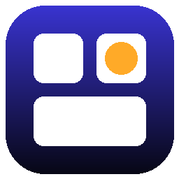

<div align="center">



# DeskWidgets

**Relógio, calendário, clima, bateria e checklist direto na sua área de trabalho.**
Personalizável, nativo do Windows e tão leve que você esquece que está aberto.

[](https://github.com/BenjamimCYT/DeskWidgets/releases/latest)
[](https://github.com/BenjamimCYT/DeskWidgets/releases)
[](#requisitos)
[](https://dotnet.microsoft.com)

### [⬇ Baixar a versão mais recente](https://github.com/BenjamimCYT/DeskWidgets/releases/latest)


</div>

---

## ✨ O que tem

| | |
|---|---|
| 🕐 **Relógio** | Qualquer fonte instalada no PC, tamanho ajustável, 12 ou 24 h e segundos opcionais |
| 📅 **Calendário** | Mês inteiro com o dia de hoje destacado e setas para navegar entre meses |
| ⛅ **Clima** | Temperatura da cidade que você escolher, com ícones que mudam conforme o tempo e entre dia e noite |
| 🔋 **Bateria** | Fones, mouses, teclados e controles conectados, em anéis coloridos por nível de carga |
| ✅ **Notas** | Checklist que expande ao clicar: Enter adiciona, Esc fecha |
| 🖼️ **Imagem** | Uma foto ou arte sua, com modo pixel art para ampliar sem borrar |

## 🎨 Do seu jeito

- **10 paletas com gradiente** prontas, ou cores livres para topo, base, destaque e texto
- **Opacidade** do fundo de 0% a 100%: no zero, só o texto e os ícones flutuam sobre o papel de parede
- **Cantos**, direção do gradiente e **tamanho** do widget ajustáveis (também com <kbd>Ctrl</kbd> + roda do mouse)
- Cada bloco pode ser ligado ou desligado
- Data em português, inglês ou espanhol
- Fica **fixo na área de trabalho**, como janela comum ou **sempre por cima**

## 🪶 Leve de verdade

O DeskWidgets foi feito para ficar parado quase o tempo todo:

- Nativo em C#/WPF, **sem navegador embutido** (nada de Electron)
- Roda em **modo de eficiência** do Windows 11, então nunca disputa CPU com jogos
- O relógio acorda **uma vez por minuto**, exatamente na virada
- Clima a cada 30 minutos e bateria a cada 3, fora da interface
- Sem animações, e a memória ociosa é devolvida ao Windows

## 🔋 Dispositivos compatíveis

| Tipo | Suporte |
|---|:---:|
| Fones, mouses, teclados e controles **Bluetooth** | ✅ |
| Dispositivos **Bluetooth LE** com serviço de bateria padrão | ✅ |
| Controles **Xbox** (adaptador sem fio ou Bluetooth) | ✅ |
| Receptores 2.4 GHz que se apresentam como bateria HID | ✅ |
| **Attack Shark X11** pelo receptor 2.4 GHz | ✅ |
| Logitech Lightspeed/Bolt, Razer HyperSpeed, Corsair Slipstream | ❌ por enquanto |

> [!TIP]
> Seu dispositivo não aparece? Abra **Configurações → Dispositivos → Copiar diagnóstico** e cole o texto numa [issue](https://github.com/BenjamimCYT/DeskWidgets/issues). Com ele dá para adicionar o suporte.

## 🖱️ Atalhos

| Ação | Como |
|---|---|
| Mover | Arraste qualquer bloco |
| Mudar o tamanho | <kbd>Ctrl</kbd> + roda do mouse sobre o widget |
| Configurações | Botão direito no widget, ícone da bandeja ou menu Iniciar |
| Abrir a checklist | Clique no bloco **Notas** |
| Atualizar o clima | Clique no clima |
| Voltar ao mês atual | Clique no nome do mês |
| Trazer de volta após <kbd>Win</kbd> + <kbd>D</kbd> | Clique no ícone da bandeja |

## Requisitos

- Windows 10 (versão 2004 ou mais recente) ou Windows 11, 64 bits
- Nada para instalar: baixe o `DeskWidgets.exe` da [release](https://github.com/BenjamimCYT/DeskWidgets/releases/latest) e abra

Configurações e notas ficam salvas em `%AppData%\DeskWidgets\`.

## ⚠️ Limitações conhecidas

- **Attack Shark X11:** a primeira porcentagem chega quando o mouse a envia (quando a carga muda ou ele acorda). Depois disso, o último valor fica salvo.
- Depois de <kbd>Win</kbd> + <kbd>D</kbd>, o widget pode ficar escondido até você clicar no ícone da bandeja.
- GIFs animados mostram só o primeiro quadro.

<details>
<summary><b>🛠️ Para desenvolvedores</b></summary>

<br>

Requer o [.NET 10 SDK](https://dotnet.microsoft.com/download).

```bash
dotnet run                 # testar
build.bat                  # gerar o .exe em publish\
```

O GitHub Actions (`.github/workflows/build.yml`) gera o `.exe` a cada push na `main`.

```
App.xaml(.cs)            instância única, bandeja do sistema
MainWindow.xaml(.cs)     o widget
SettingsWindow.xaml(.cs) configurações (aplicam na hora)
Services/                clima, bateria, mouses 2.4 GHz, atalhos, configurações
Helpers/                 ícones de clima, cores, chamadas nativas do Windows
```

Para adicionar um mouse 2.4 GHz, inclua o VID/PID e o formato do pacote na tabela `Known` de `Services/VendorHidBattery.cs`.

</details>

## 🙏 Créditos

- Suporte ao Attack Shark X11 baseado na engenharia reversa de [OpenSharkX11](https://github.com/clevim/OpenSharkX11) e [attack-shark-x11-driver](https://github.com/HarukaYamamoto0/attack-shark-x11-driver)
- Dados de clima: [Open-Meteo](https://open-meteo.com)

<div align="center">
<sub>Feito por <a href="https://github.com/BenjamimCYT">@BenjamimCYT</a></sub>
</div>
